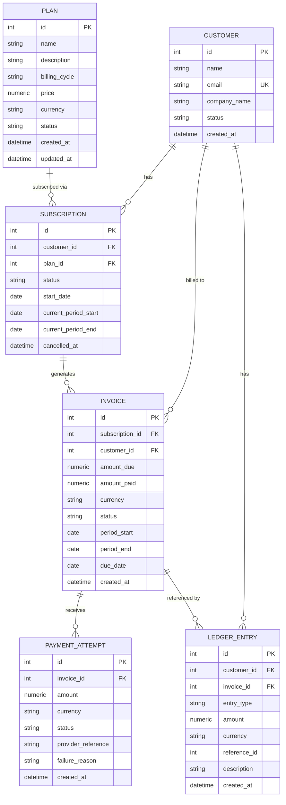

# SubLedger: Low-Level Design

Source order: BRIEF.md, RULES.md, ARCHITECTURE.md. Anything not stated there is marked **(assumed)**.

Stack: Python, FastAPI, SQLAlchemy 2.x, Pydantic v2, SQLite, pytest, Docker.

## 1. Layering

```
routes -> services -> repositories -> models
```

- Routes parse input, call one service method, return the response. No logic.
- Services own all validation and business rules and raise domain exceptions (`NotFound`, `BusinessRuleViolation`).
- Repositories do DB access only. No business rules.
- Models are SQLAlchemy 2.x declarative classes. Schemas are Pydantic v2 request/response models.
- Dependencies are injected with FastAPI `Depends`. Repositories are passed into service `__init__`.

## 2. Entity Relationship Diagram



Field names are exactly those in BRIEF.md section 4. **No extra fields were added.**

### 2.1 Column types and constraints

| Entity | Notes |
|---|---|
| Plan | `price` Numeric(12,2), CHECK `price > 0` (defence in depth; the service is the owner). `description` nullable. `updated_at` is set on creation and on every update. |
| Customer | `email` UNIQUE, NOT NULL. `company_name` nullable. |
| Subscription | `cancelled_at` nullable. `current_period_*` and `start_date` are dates. |
| Invoice | `amount_due`, `amount_paid` Numeric(12,2). `amount_paid` defaults to 0. Dates are `period_start`, `period_end`, `due_date`. |
| PaymentAttempt | `provider_reference` nullable and **not unique**. `failure_reason` nullable, set only when `status=failed`. |
| LedgerEntry | `customer_id` and `invoice_id` both NOT NULL **(assumed)**. `reference_id` is an integer with no FK, since it points to an invoice or a payment attempt depending on `entry_type`. |

Types **(assumed)**: `created_at` and `cancelled_at` are UTC datetimes. Currency is a 3-letter uppercase code with no whitelist. Email is trimmed and lowercased before the uniqueness check. Money is `Decimal` / `Numeric(12,2)`, never float.

**Money handling.** All money amounts (`price`, `amount_due`, `amount_paid`, payment `amount`, ledger `amount`) are `Decimal`, never float. The Pydantic schemas quantize every incoming amount to 2 decimal places (`Decimal("0.01")`, `ROUND_HALF_UP` **(assumed)**) and enforce `max_digits=12`, matching `Numeric(12,2)`. Validation runs after quantization, so `0.004` becomes `0.00` and fails `price > 0`. Because incoming and stored values both carry exactly 2 decimal places, comparisons such as `amount_paid == amount_due` and `amount <= amount_due - amount_paid` are reliable.

### 2.2 Enums

| Field | Values | Source |
|---|---|---|
| Plan.billing_cycle | `monthly`, `quarterly`, `yearly` | Brief names these three plus "custom if explained". Custom is **not supported (assumed)**. |
| Plan.status | `active`, `inactive` | assumed |
| Customer.status | `active`, `inactive` | assumed. Always created `active`; no endpoint changes it and no rule reads it. |
| Subscription.status | `active`, `cancelled` | assumed |
| Invoice.status | `draft`, `issued`, `partially_paid`, `paid`, `overdue`, `void` | Brief. Only `issued`, `partially_paid` and `paid` are reachable; there is no overdue job and no void endpoint **(assumed)**. |
| PaymentAttempt.status | `success`, `failed` | Brief |
| LedgerEntry.entry_type | `invoice_created`, `payment_success`, `payment_failure` | Brief |

## 3. Service responsibilities

| Service | Owns | Must not |
|---|---|---|
| PlanService | Validate price > 0, billing cycle, and status changes. Create, update, list plans. Deactivation is `status=inactive`. | Touch subscriptions or invoices. |
| CustomerService | Create customers, check email uniqueness, fetch and list customers. | Create subscriptions or ledger entries. |
| SubscriptionService | Create and cancel subscriptions, check the plan is active, prevent duplicate active subscription to the same plan, list subscriptions, derive `current_period_*`. | Generate invoices or record payments. |
| InvoiceService | Generate invoices: verify the subscription is active, read the plan price, calculate `amount_due` and period, write the `invoice_created` ledger entry via LedgerService. Fetch invoices. | Update invoice status after payment (see 5, decision D2). Write to the ledger repository directly. |
| PaymentService | Validate payment (invoice status, amount, currency), create the attempt, compute `amount_paid` and invoice status, trigger the ledger entry. | Generate invoices. Write to the ledger repository directly. |
| LedgerService | Create append-only ledger entries (`record_invoice_created`, `record_payment`) and fetch customer ledger history. | Update or delete entries. Commit when called from another service. |

## 4. Repository responsibilities

Repositories add and flush only. A base repository exposes `commit()`, which services call once per operation.

| Repository | Reads / writes | Methods |
|---|---|---|
| PlanRepository | Plan | `add`, `get`, `list`, `save` (flush after in-place update) |
| CustomerRepository | Customer | `add`, `get`, `get_by_email`, `list` |
| SubscriptionRepository | Subscription | `add`, `get`, `list`, `find_active(customer_id, plan_id)`, `save` |
| InvoiceRepository | Invoice | `add`, `get`, `save` |
| PaymentAttemptRepository | PaymentAttempt | `add`, `get`, `list_by_invoice` |
| LedgerRepository | LedgerEntry | `create`, `list_by_customer` (ordered by `created_at, id` ascending). **No update or delete methods exist.** |

## 5. Business rule ownership

Owners are from RULES.md. "Enforced by" lists every layer that participates.

| # | Rule | Owner | Enforced by |
|---|------|-------|-------------|
| 1 | Plan price > 0 | PlanService | Pydantic schema (`gt=0`, returns 422), PlanService (create and update), DB CHECK |
| 2 | Customer email unique | CustomerService | CustomerService via `CustomerRepository.get_by_email`, plus DB UNIQUE constraint as backstop |
| 3 | No subscription on an inactive plan | SubscriptionService | SubscriptionService checks `plan.status == active` |
| 4 | No two active subscriptions to the same plan per customer | SubscriptionService | SubscriptionService via `SubscriptionRepository.find_active(customer_id, plan_id)`. Not DB-enforced (see limitations). |
| 5 | Invoice `amount_due` = plan price at generation time | InvoiceService | InvoiceService reads `plan.price` at generation and stores it on the invoice |
| 6 | Successful payment cannot exceed remaining unpaid amount | PaymentService | PaymentService: `amount <= amount_due - amount_paid` |
| 7 | Fully paid -> `paid`; partial -> `partially_paid` | PaymentService | PaymentService computes status from the new `amount_paid` |
| 8 | Failed payment never increases `amount_paid` | PaymentService | PaymentService does not touch the invoice on failure |
| 9 | Ledger is append-only and traceable via `reference_id` | LedgerService | LedgerService and LedgerRepository expose create and read only; `reference_id` set on every entry |

Decisions that resolve gaps in the brief:

- **D1 (billing period)** **(assumed)**: `period_start` defaults to the subscription's `current_period_start`. `period_end = period_start + cycle length` (monthly 1 month, quarterly 3, yearly 12). If the request supplies both dates, those win and `period_end` must be after `period_start`. `due_date = period_end`. Invoice generation does not advance the subscription's `current_period_*`.
- **D2 (invoice status updates)** **(assumed)**: the brief's InvoiceService row says "update invoice status after payment", but its PaymentService row, payment flow step 6 and RULES.md rule 7 give this to PaymentService. PaymentService computes `amount_paid` and status and saves them through InvoiceRepository. InvoiceService only generates and fetches invoices.
- **D3 (payment status gate)** **(approved)**: successful payments are accepted only on invoices with status `issued` or `partially_paid`. Any other status is a `BusinessRuleViolation`. Failed attempts use the same gate **(approved)**.
- **D4 (failed payment validation)**: amount > 0 and currency matching the invoice. A failed attempt is not bounded by the remaining amount.
- **D5 (invoice generation after plan deactivation)** **(approved)**: invoice generation is allowed for an active subscription even if its plan has since become `inactive`. An inactive plan blocks only the creation of new subscriptions (rule 3). InvoiceService checks the subscription's status only and bills at the plan's current `price` (rule 5).

## 6. Design pattern

**Repository Pattern**, combined with a **Service Layer**.

- Repositories isolate all SQLAlchemy queries behind small, entity-focused classes. Services depend on repository methods, not on sessions or queries, so business rules can be read and tested without SQL.
- The service layer holds every workflow and rule, so routes stay thin and rules are not duplicated across endpoints.
- Both are wired by constructor injection through `Depends`, which lets tests swap in an in-memory SQLite session.

## 7. API surface (BRIEF.md section 6)

| Method | Endpoint | Service call |
|---|---|---|
| POST | /plans | PlanService.create |
| GET | /plans | PlanService.list |
| PATCH | /plans/{plan_id} | PlanService.update |
| POST | /customers | CustomerService.create |
| GET | /customers | CustomerService.list |
| GET | /customers/{customer_id} | CustomerService.get |
| POST | /subscriptions | SubscriptionService.create |
| GET | /subscriptions | SubscriptionService.list |
| PATCH | /subscriptions/{subscription_id}/cancel | SubscriptionService.cancel |
| POST | /invoices/generate | InvoiceService.generate_invoice |
| GET | /invoices/{invoice_id} | InvoiceService.get |
| POST | /payments/record | PaymentService.record_payment |
| GET | /customers/{customer_id}/ledger | LedgerService.get_customer_ledger |

Request shapes and gaps **(assumed)**:

- `POST /subscriptions`: `customer_id`, `plan_id`, optional `start_date` (default today). The subscription is created directly as `active`. The brief lists "activate" but defines no endpoint, so there is no separate activate route. There is no `GET /subscriptions/{id}` in the brief, so the list endpoint covers fetching.
- `PATCH /subscriptions/{id}/cancel`: sets `status=cancelled` and `cancelled_at=now`. Cancelling an already cancelled subscription is a `BusinessRuleViolation`.
- `PATCH /plans/{id}`: partial update of `name`, `description`, `billing_cycle`, `price`, `currency`, `status`. Price is re-validated. Price changes affect future invoices only (rule 5).
- `POST /invoices/generate`: `subscription_id`, optional `period_start` and `period_end`.
- `POST /payments/record`: `invoice_id`, `amount`, `currency`, `status`, `provider_reference`, and an optional `failure_reason`. The brief's flow says to store a reason but lists no request field for it.
- `GET /customers/{id}/ledger`: returns 404 if the customer does not exist. History is ordered by `created_at, id` ascending and is not paginated.

## 8. Invoice generation flow

1. Route receives `subscription_id` and the optional billing period, and calls `InvoiceService.generate_invoice`.
2. InvoiceService fetches the subscription via SubscriptionRepository. Missing: `NotFound`.
3. It verifies `status == active`. Otherwise: `BusinessRuleViolation`.
4. It fetches the plan via PlanRepository and reads the current `price` and `currency` (rule 5).
5. It calculates the period per D1 and `due_date = period_end`.
6. InvoiceRepository creates the invoice with `status=issued`, `amount_due=plan.price`, `amount_paid=0`, `customer_id` from the subscription.
7. LedgerService writes an `invoice_created` entry: `amount=amount_due`, `reference_id=invoice.id`.
8. InvoiceService commits once (invoice and ledger entry are atomic).
9. Route returns the invoice response.

```python
def generate_invoice(self, subscription_id, period_start=None, period_end=None):
    sub = self.subscription_repo.get(subscription_id)
    if sub is None:
        raise NotFound("subscription")
    if sub.status != "active":
        raise BusinessRuleViolation("subscription is not active")
    plan = self.plan_repo.get(sub.plan_id)
    start, end = resolve_period(sub, plan, period_start, period_end)   # D1
    invoice = self.invoice_repo.add(Invoice(
        subscription_id=sub.id, customer_id=sub.customer_id,
        amount_due=plan.price, amount_paid=Decimal("0.00"),
        currency=plan.currency, status="issued",
        period_start=start, period_end=end, due_date=end))
    self.ledger_service.record_invoice_created(invoice)   # flush only
    self.invoice_repo.commit()
    return invoice
```

## 9. Payment recording flow

1. Route receives `invoice_id`, `amount`, `currency`, `status`, `provider_reference`, optional `failure_reason`, and calls `PaymentService.record_payment`.
2. PaymentService fetches the invoice via InvoiceRepository. Missing: `NotFound`.
3. It validates:
   - invoice status is `issued` or `partially_paid`, otherwise `BusinessRuleViolation` (D3);
   - `amount > 0`;
   - `currency` equals the invoice currency;
   - for `success` only: `amount <= amount_due - amount_paid` (rule 6).
4. PaymentAttemptRepository creates the attempt.
5. **On failure:** store `failure_reason` on the attempt. `amount_paid` and invoice status are not touched (rule 8).
6. **On success:** `amount_paid += amount`. Status becomes `paid` if `amount_paid == amount_due`, otherwise `partially_paid` (rule 7). The invoice is saved via InvoiceRepository.
7. LedgerService writes `payment_success` or `payment_failure`: `amount=attempt.amount`, `reference_id=attempt.id`.
8. PaymentService commits once (attempt, invoice update and ledger entry are atomic).
9. Route returns the payment attempt and the invoice status.

```python
def record_payment(self, invoice_id, amount, currency, status, provider_reference, failure_reason=None):
    invoice = self.invoice_repo.get(invoice_id)
    if invoice is None:
        raise NotFound("invoice")
    if invoice.status not in ("issued", "partially_paid"):
        raise BusinessRuleViolation("invoice does not accept payments")
    if amount <= 0 or currency != invoice.currency:
        raise BusinessRuleViolation("invalid amount or currency")
    if status == "success" and amount > invoice.amount_due - invoice.amount_paid:
        raise BusinessRuleViolation("payment exceeds remaining amount")
    attempt = self.payment_attempt_repo.add(PaymentAttempt(
        invoice_id=invoice.id, amount=amount, currency=currency,
        status=status, provider_reference=provider_reference,
        failure_reason=failure_reason if status == "failed" else None))
    if status == "success":
        invoice.amount_paid += amount
        invoice.status = "paid" if invoice.amount_paid == invoice.amount_due else "partially_paid"
        self.invoice_repo.save(invoice)
    self.ledger_service.record_payment(attempt, invoice)   # flush only
    self.payment_attempt_repo.commit()
    return attempt, invoice
```

## 10. Transactions and error handling

- Repositories add and flush only. Each service operation commits once at the end via the base repository `commit()`. LedgerService does not commit when called from another service **(assumed)**.
- Invoice + ledger writes are atomic (ARCHITECTURE.md). Payment attempt + invoice update + ledger entry are also atomic **(assumed extension)**.
- One exception handler maps domain exceptions to HTTP **(assumed)**: `NotFound` -> 404, `BusinessRuleViolation` -> 409. Pydantic validation errors (for example price <= 0) stay at 422.

## 11. Testing plan

pytest with in-memory SQLite. At least one test per rule, ideally more:

| Rule | Test |
|---|---|
| 1 | Create and update plan with price <= 0 is rejected |
| 2 | Duplicate email (including different casing) is rejected |
| 3 | Subscribe to an inactive plan is rejected |
| 4 | Second active subscription to the same plan is rejected; after cancel, allowed |
| 5 | Invoice `amount_due` equals the plan price at generation, and later plan price changes do not alter it |
| 6 | Successful payment above the remaining amount is rejected |
| 7 | Full payment -> `paid`; partial -> `partially_paid` |
| 8 | Failed payment leaves `amount_paid` unchanged and stores `failure_reason` |
| 9 | Ledger entries exist for all three event types with correct `reference_id`; no update/delete method is exposed |
| D3 | Successful payment on a `paid` invoice is rejected |

## 12. Limitations

- `provider_reference` is not unique, so a duplicate reference is not detected and retries can create duplicate attempts.
- Rule 4 is enforced in the service only, so concurrent requests could create duplicate active subscriptions (no DB-level constraint).
- SQLite has no native decimal type. Values with 2 decimal places round-trip exactly through SQLAlchemy `Numeric(12,2)` in the checks run so far, but SQLite stores them as floating point internally. Use PostgreSQL for exact decimal storage.
- No pagination on list endpoints.
- `overdue` and `void` invoice statuses exist but are unreachable. `draft` is unused.
- No duplicate-invoice-per-period check. The same subscription and period can be invoiced twice.
- No currency conversion and no currency whitelist. Custom billing cycles, proration, taxes, authentication and a real payment gateway are out of scope per the brief.
- No endpoint to change customer status or to fetch a single subscription.
- SQLite returns `created_at`, `updated_at` and `cancelled_at` without timezone information even though values are written in UTC.
- Python 3.10+ is required (models use `str | None`).
- No migrations: tables are created on startup with `create_all`.
- Failed payment attempts use the same status gate as successful ones (D3). A failure reported against a `paid` invoice, or any status other than `issued` or `partially_paid`, is rejected with a `BusinessRuleViolation`. No payment attempt or ledger entry is created, so that failure is not recorded.

## 13. Implementation notes

- **Partial billing period (extends D1):** if only `period_start` is supplied, `period_end` is computed from it; if only `period_end` is supplied, `period_start` defaults to the subscription's `current_period_start`. In every case `period_end` must be after `period_start`, otherwise `BusinessRuleViolation`.
- **Unknown references:** creating a subscription for a customer or plan that does not exist returns 404 (`NotFound`).
- **Payment response:** `POST /payments/record` returns `payment_attempt` and the full updated `invoice` (which carries `status` and `amount_paid`).
- **Failure reason:** stored only when the attempt status is `failed`; ignored for `success`. If a failed attempt is sent without a reason it is stored as null.
- **Currency on payments:** the attempt stores the invoice's currency after the match check.
- **Race backstop:** if two concurrent requests pass the email check, the DB UNIQUE constraint rejects the second and CustomerService converts the `IntegrityError` into a `BusinessRuleViolation` (409).
- **Dependency injection:** `app/api/deps.py` builds each service from repositories that share one per-request session.
- **Month arithmetic:** adding months clamps the day to the end of the month (31 Jan + 1 month = 28/29 Feb).
